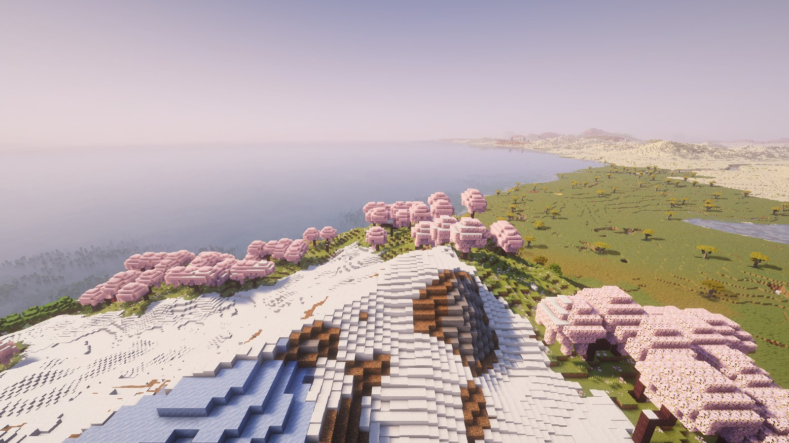
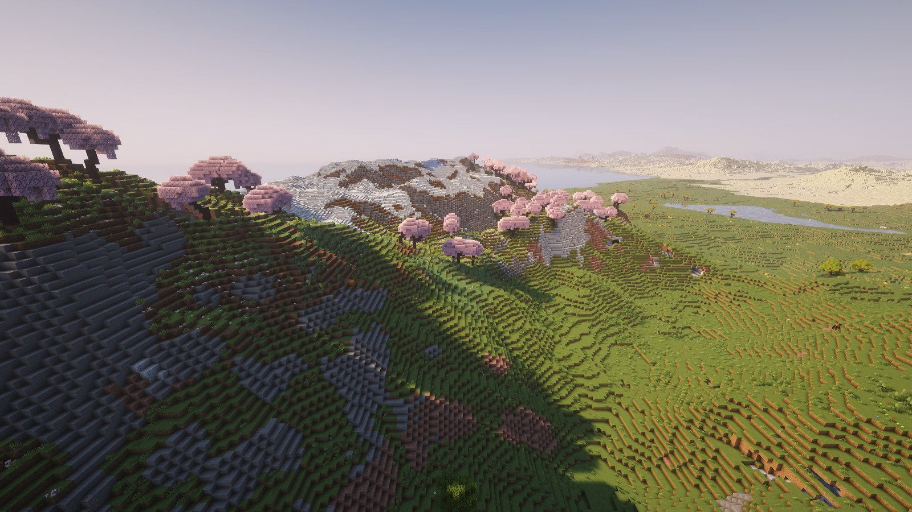
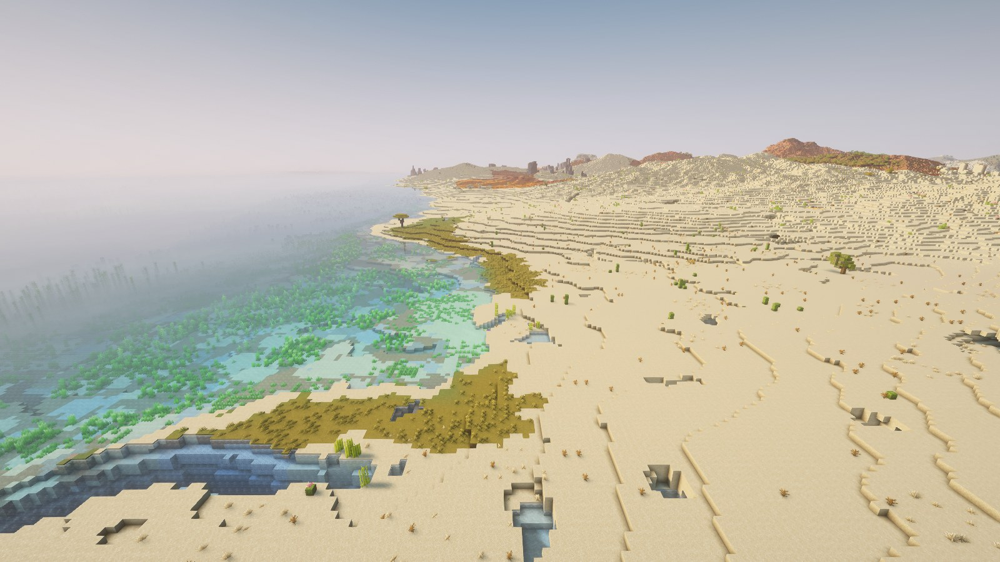
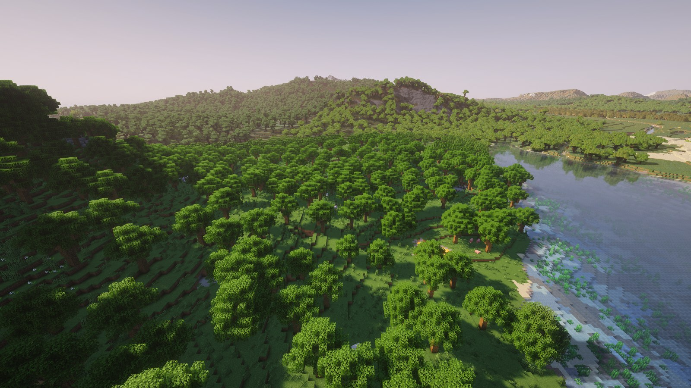
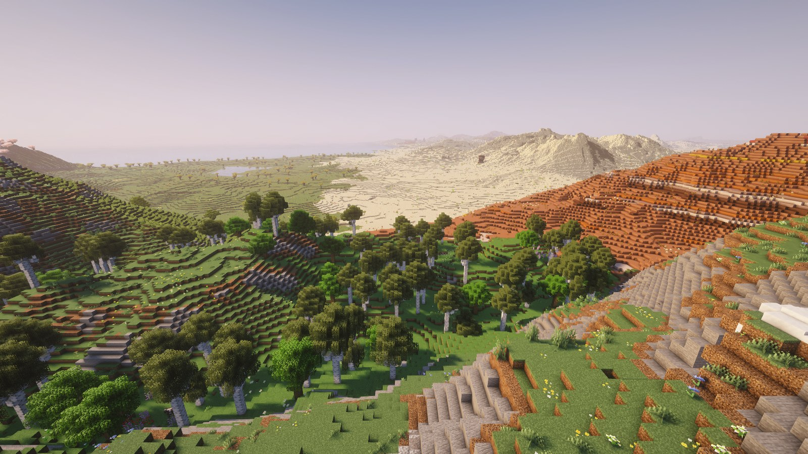
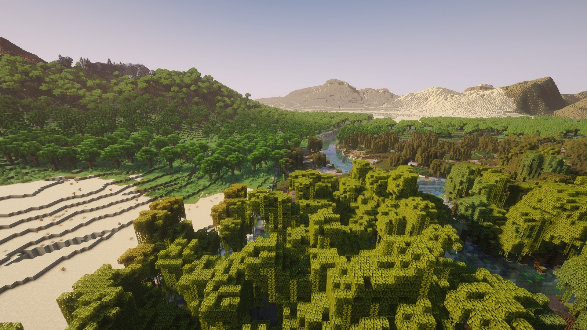
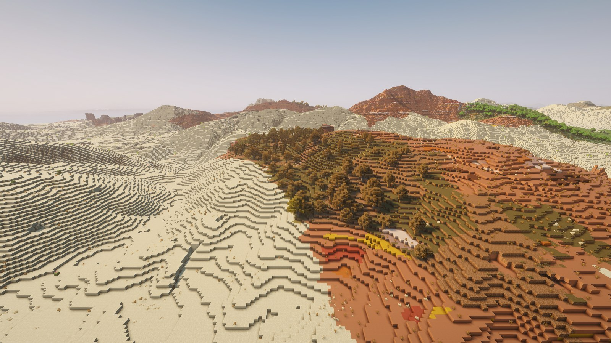

# ReTerraForged (fork for 1.21.1+)

Рабочий форк [ReterraForged](https://github.com/Campione01/ReterraForged) (Campione01, поверх racoonman2 / TerraForged,
лицензия **MIT**) — той же сборки, что лежит на CurseForge как «ReTerraforged Unofficial» (автор пометил её брошенной).
NeoForge и Fabric. История коммитов авторов сохранена.

Генерация мира как в оригинальном ReTerraForged 0.0.6 (1.20.1) — с исправленными ошибками, на Minecraft 1.21.1 – 26.3,
на 10 языках (русский, английский, китайский, немецкий, французский, испанский, португальский, японский, корейский,
польский).

|  |  |
|---|---|
|  |  |
|  |  |
|  |  |

Minecraft 26.3, ReTerraForged 0.0.12, пресет «Default» с высотой мира 384, размером биомов 300 и горами ×1.15.
Шейдеры Complementary Reimagined (Iris) и Distant Horizons с прорисовкой 256 чанков — только для картинок, мод от них
не зависит. Снято `tools/showcase.sh`.

## Версии

| Minecraft | Релиз | NeoForge | Fabric Loader / API | Ветка |
|---|---|---|---|---|
| 1.21.1 | [0.0.12](https://github.com/Vladeezyy/reterraforged/releases/tag/v0.0.12-1.21.1) | 21.1.201 | 0.16.3 / 0.102 | `main` |
| 1.21.3 | [0.0.12](https://github.com/Vladeezyy/reterraforged/releases/tag/v0.0.12-1.21.3) | 21.3.97 | 0.16.14 / 0.114 | `mc/1.21.3` |
| 1.21.4 | [0.0.12](https://github.com/Vladeezyy/reterraforged/releases/tag/v0.0.12-1.21.4) | 21.4.158 | 0.16.14 / 0.119 | `mc/1.21.4` |
| 1.21.5 | [0.0.12](https://github.com/Vladeezyy/reterraforged/releases/tag/v0.0.12-1.21.5) | 21.5.98 | 0.16.14 / 0.128 | `mc/1.21.5` |
| 1.21.8 | [0.0.12](https://github.com/Vladeezyy/reterraforged/releases/tag/v0.0.12-1.21.8) | 21.8.54 | 0.17.2 / 0.136 | `mc/1.21.8` |
| 1.21.10 | [0.0.12](https://github.com/Vladeezyy/reterraforged/releases/tag/v0.0.12-1.21.10) | 21.10.64 | 0.17.3 / 0.138 | `mc/1.21.10` |
| 1.21.11 | [0.0.12](https://github.com/Vladeezyy/reterraforged/releases/tag/v0.0.12-1.21.11) | 21.11.45 | 0.17.3 / 0.141 | `mc/1.21.11` |
| 26.1.2 | [0.0.12](https://github.com/Vladeezyy/reterraforged/releases/tag/v0.0.12-26.1.2) | 26.1.2.116 | 0.19.5 / 0.155 | `mc/26.1.2` |
| 26.2 | [0.0.12](https://github.com/Vladeezyy/reterraforged/releases/tag/v0.0.12-26.2) | 26.2.0.90 | 0.19.5 / 0.161 | `mc/26.2` |
| 26.3 | [0.0.12](https://github.com/Vladeezyy/reterraforged/releases/tag/v0.0.12-26.3) | 26.3.0.76 | 0.19.5 / 0.162 | `mc/26.3` |

В каждом релизе — jar для NeoForge, jar для Fabric и датапак пресета для серверов. 1.21.x — Java 21, 26.x — Java 25.
Сервер: jar в `mods/`, для нового мира датапак `reterraforged-preset-<версия>.zip` в `world/datapacks/` (без него
серверный мир будет ванильным); в одиночной игре пресет выбирается при создании мира → «Настроить».

## Что исправлено в форке

- **Новый мир не создавался:** в последнем коммите апстрима в миксин `MixinNoiseChunk` добавили не-`private` статический
  метод, Mixin такое запрещает, и генерация падала сразу при создании мира. Метод вынесен в `C2MECompat`.
- **Сервер зависал при генерации Незера и Энда** (Fabric): фичи эрозии и снега мода попадали в биомы других измерений и
  бросали исключение — чанк не догенерировался. Теперь вне генератора ReTerraForged они ничего не делают.
- **Одиночная игра на Fabric зависала** на новых чанках после загрузки мира (`Index -1 out of bounds`): Fabric не
  пересчитывал у генератора список фич после изменений биомов модом.
- **Экран пресетов в 1.21.6+** ронял игру (`Can only blur once per frame`) и терял все надписи.
- **Перезагрузка шаблонов деревьев** (`/reload`) на NeoForge держалась на имени скомпилированной лямбды и в других версиях
  молча не работала; миксины, завязанные на полные сигнатуры конструкторов, заменены устойчивыми.
- **Мод грузился на любой версии Minecraft** и падал на чужой — теперь в метаданных точные диапазоны версий; версия мода в
  `neoforge.mods.toml` была 0.0.6 вместо настоящей.
- **Обрезанные кнопки** на экране пресетов в маленьком окне.
- **Утечка памяти** (0.0.9): кэши генератора (тайлы, карты рек) не освобождались никогда — каждое перестроение превью и
  каждый вход в мир оставляли их в памяти до закрытия игры, с тяжёлыми настройками — вылет по нехватке памяти.
- **Генерация снова как в оригинальном ReTerraForged 0.0.6** (0.0.11–0.0.12): порт на 1.21.1 менял её сверх
  нужного (Default, климат гор, реки, озёра, болота, структуры на горах, пустыни, кусты, глубина пещерных биомов) —
  всё возвращено, вариант порта остался отдельным пресетом и переключателем «Original Generation». Заработала страница
  структур, /locate и карты картографа больше не вешают сервер. В 0.0.12 каждый класс мода сверен с исходником 0.0.6:
  ещё возвращены крутизна склонов (камень и снег на горах) и пустые карты рек в открытом океане.
- **Ульи на деревьях мода** (0.0.12): ванильный декоратор не находил места на деревьях-шаблонах — ульев не было и в 0.0.6.
- **26.x: деревья ReTerraForged не росли** (0.0.12): с 26.1 трава не входит в тег `#dirt` (деревья не ставились на траву,
  эрозия не трогала травяные склоны), а с 26.3 блоки шаблонов читаются по другим ключам и становились воздухом.
- **NeoForge: деревья пресета не появлялись** (0.0.10): модификаторы биомов лежали в реестре Forge
  `forge:biome_modifier`, которого в NeoForge нет, — все деревья были ванильными.
- **Ползунки экрана пресетов ничего не меняли на 1.21.11+**, выбранный пресет не подсвечивался, повторно применённый
  пресет и правки встроенного пресета терялись, «<<» со страницы рек перескакивал две страницы (0.0.10).
- **NaN в рельефе** (0.0.9): горизонтальный масштаб рельефа 0, совпадающие контрольные точки океан/суша, реки нулевой
  длины на крошечных континентах, минимальный глобальный масштаб у границы мира.

## Проверка

Стресс-тест настроек: `tools/stresstest.sh` (команда `rtf stress`) — каждый из 166 параметров экрана пресетов на
минимуме и максимуме ползунка, все встроенные пресеты, всё на минимуме, всё на максимуме и случайные комбинации; каждый
вариант проходит кодек пресета, сборку датапака мира, превью и тайлы мира с эрозией (562 варианта, все проходят).
`tools/stressworld.sh` — настоящие миры с экстремальными пресетами. Таблица параметров генерируется из страниц экрана
пресетов (`tools/stresstable.py`).

Каждая версия проверяется двумя скриптами (работают и в Git Bash на Windows):

- `tools/servertest.sh` — ставит настоящие серверы NeoForge и Fabric нужной версии, выгружает пресет «Default» командой
  `rtf exportpreset`, создаёт с ним новый мир и выполняет `rtf selftest`: мир строит ReTerraForged, рельеф, море, спавн на
  суше, деревня на земле, бедрок в обычном мире и Незере целый, Незер из незерака, Энд на месте — **13/13 и ноль ошибок
  мода в логе на всех версиях из таблицы**;
- `tools/clienttest.sh neoforge|fabric` — запускает клиент: экран пресетов с живой картой-превью, затем мир из серверного
  теста — самая высокая гора, пустыня, река, вид сверху. Скриншоты одинаковые на всех версиях (один сид — один рельеф).

В логах клиента бывают строки «setBlock in a far chunk» от ванильных больших сталактитов (`large_dripstone`) — это
поведение самого Minecraft, мод эту фичу не трогает.

|  |  |
|---|---|
|  |  |

---

# ReTerraForged

Terrain generation for Minecraft 1.21.1 – 26.3 on NeoForge and Fabric (see the table above).

## Island generation

- Optional archipelagos with configurable density, size, height, and terrain scale.
- Dedicated island mountains and volcano-shaped peaks.
- Adjustable offshore depth, beach width, beach coverage, and coast transitions.
- Island-aware climate routing and beach-biome selection that avoids stone-shore dominance.
