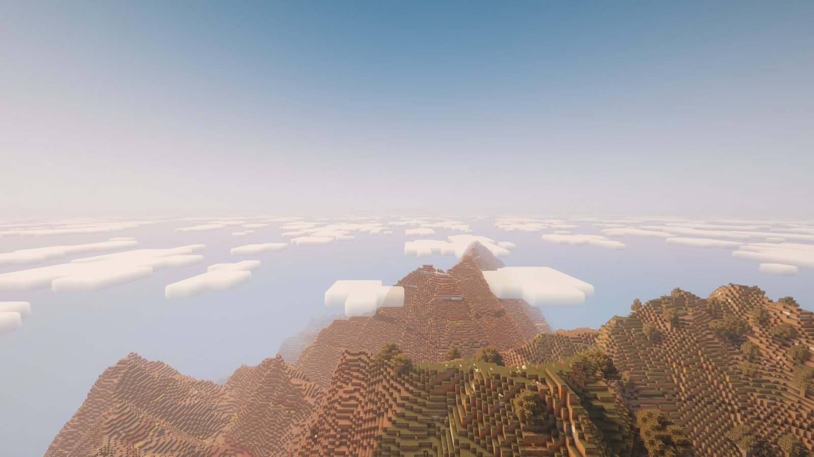
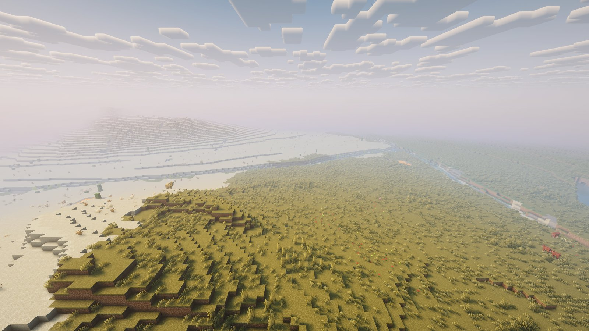
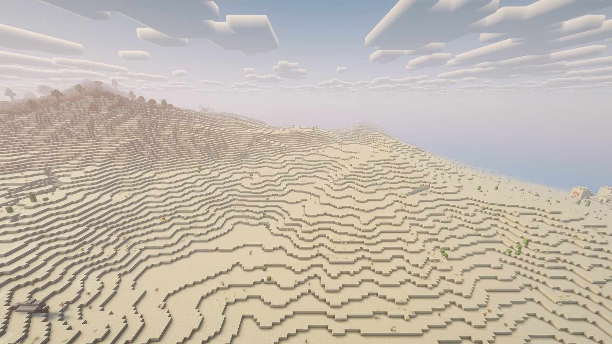
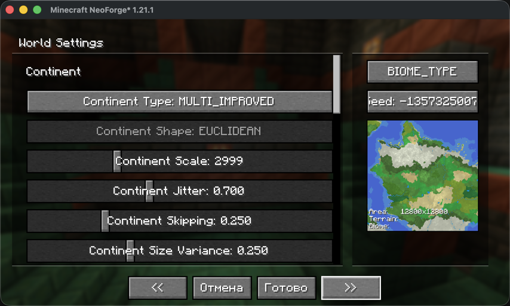
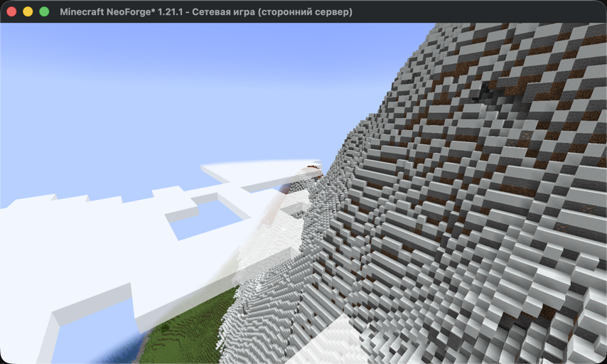
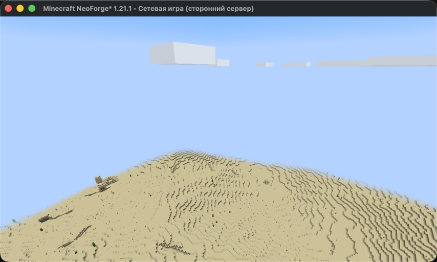
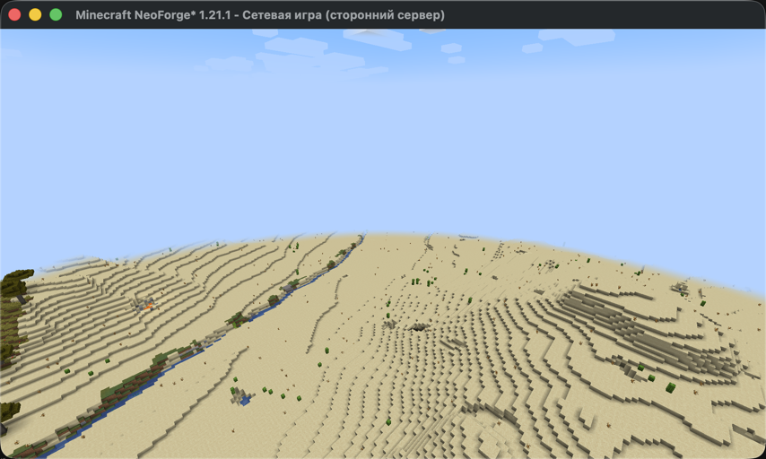
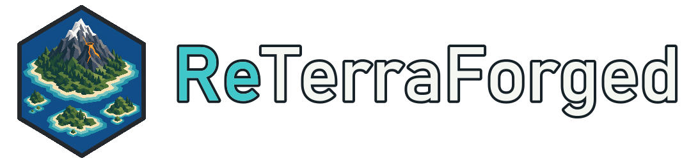

# ReTerraForged (fork for 1.21.1+)

Рабочий форк [ReterraForged](https://github.com/Campione01/ReterraForged) (Campione01, поверх racoonman2 / TerraForged,
лицензия **MIT**) — той же сборки, что лежит на CurseForge как «ReTerraforged Unofficial» (автор пометил её брошенной).
NeoForge и Fabric. История коммитов авторов сохранена.

|  |  |
|---|---|

Minecraft 26.2, пресет «Default», шейдеры Complementary Reimagined (Iris) — только для картинок, мод от них не
зависит. Снято `tools/showcase.sh`.

## Версии

| Minecraft | Релиз | NeoForge | Fabric Loader / API | Ветка |
|---|---|---|---|---|
| 1.21.1 | [0.0.8](https://github.com/Vladeezyy/reterraforged/releases/tag/v0.0.8-1.21.1) | 21.1.201 | 0.16.3 / 0.102 | `main` |
| 1.21.3 | [0.0.8](https://github.com/Vladeezyy/reterraforged/releases/tag/v0.0.8-1.21.3) | 21.3.97 | 0.16.14 / 0.114 | `mc/1.21.3` |
| 1.21.4 | [0.0.8](https://github.com/Vladeezyy/reterraforged/releases/tag/v0.0.8-1.21.4) | 21.4.158 | 0.16.14 / 0.119 | `mc/1.21.4` |
| 1.21.5 | [0.0.8](https://github.com/Vladeezyy/reterraforged/releases/tag/v0.0.8-1.21.5) | 21.5.98 | 0.16.14 / 0.128 | `mc/1.21.5` |
| 1.21.8 | [0.0.8](https://github.com/Vladeezyy/reterraforged/releases/tag/v0.0.8-1.21.8) | 21.8.54 | 0.17.2 / 0.136 | `mc/1.21.8` |
| 1.21.10 | [0.0.8](https://github.com/Vladeezyy/reterraforged/releases/tag/v0.0.8-1.21.10) | 21.10.64 | 0.17.3 / 0.138 | `mc/1.21.10` |
| 1.21.11 | [0.0.8](https://github.com/Vladeezyy/reterraforged/releases/tag/v0.0.8-1.21.11) | 21.11.45 | 0.17.3 / 0.141 | `mc/1.21.11` |
| 26.1.2 | [0.0.8](https://github.com/Vladeezyy/reterraforged/releases/tag/v0.0.8-26.1.2) | 26.1.2.116 | 0.19.5 / 0.155 | `mc/26.1.2` |
| 26.2 | [0.0.8](https://github.com/Vladeezyy/reterraforged/releases/tag/v0.0.8-26.2) | 26.2.0.90 | 0.19.5 / 0.161 | `mc/26.2` |
| 26.3 | в работе | | | |

В каждом релизе — jar для NeoForge, jar для Fabric и датапак пресета для серверов. 1.21.x — Java 21, 26.x — Java 25.
Сервер: jar в `mods/`, для нового мира датапак `reterraforged-preset-<версия>.zip` в `world/datapacks/` (без него
серверный мир будет ванильным); в одиночной игре пресет выбирается при создании мира → «Настроить».

## Что исправлено в форке

- **Новый мир не создавался:** в последнем коммите апстрима в миксин `MixinNoiseChunk` добавили не-`private` статический
  метод, Mixin такое запрещает, и генерация падала сразу при создании мира. Метод вынесен в `C2MECompat`.
- **Сервер зависал при генерации Незера и Энда** (Fabric): фичи эрозии и снега мода попадали в биомы других измерений и
  бросали исключение — чанк не догенерировался. Теперь вне генератора ReTerraForged они ничего не делают.
- **Одиночная игра на Fabric зависала** на новых чанках после загрузки мира (`Index -1 out of bounds`): Fabric не
  пересчитывал у генератора список фич после изменений биомов модом.
- **Экран пресетов в 1.21.6+** ронял игру (`Can only blur once per frame`) и терял все надписи.
- **Перезагрузка шаблонов деревьев** (`/reload`) на NeoForge держалась на имени скомпилированной лямбды и в других версиях
  молча не работала; миксины, завязанные на полные сигнатуры конструкторов, заменены устойчивыми.
- **Мод грузился на любой версии Minecraft** и падал на чужой — теперь в метаданных точные диапазоны версий; версия мода в
  `neoforge.mods.toml` была 0.0.6 вместо настоящей.
- **Обрезанные кнопки** на экране пресетов в маленьком окне.

## Проверка

Каждая версия проверяется двумя скриптами (работают и в Git Bash на Windows):

- `tools/servertest.sh` — ставит настоящие серверы NeoForge и Fabric нужной версии, выгружает пресет «Default» командой
  `rtf exportpreset`, создаёт с ним новый мир и выполняет `rtf selftest`: мир строит ReTerraForged, рельеф, море, спавн на
  суше, деревня на земле, бедрок в обычном мире и Незере целый, Незер из незерака, Энд на месте — **13/13 и ноль ошибок
  мода в логе на всех версиях из таблицы**;
- `tools/clienttest.sh neoforge|fabric` — запускает клиент: экран пресетов с живой картой-превью, затем мир из серверного
  теста — самая высокая гора, пустыня, река, вид сверху. Скриншоты одинаковые на всех версиях (один сид — один рельеф).

В логах клиента бывают строки «setBlock in a far chunk» от ванильных больших сталактитов (`large_dripstone`) — это
поведение самого Minecraft, мод эту фичу не трогает.

|  |  |
|---|---|
|  |  |

---

# ReTerraForged

Terrain generation for Minecraft 1.21.1 – 26.2 on NeoForge and Fabric (see the table above).

## Island generation

- Optional archipelagos with configurable density, size, height, and terrain scale.
- Dedicated island mountains and volcano-shaped peaks.
- Adjustable offshore depth, beach width, beach coverage, and coast transitions.
- Island-aware climate routing and beach-biome selection that avoids stone-shore dominance.
